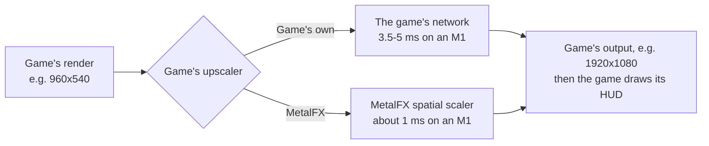
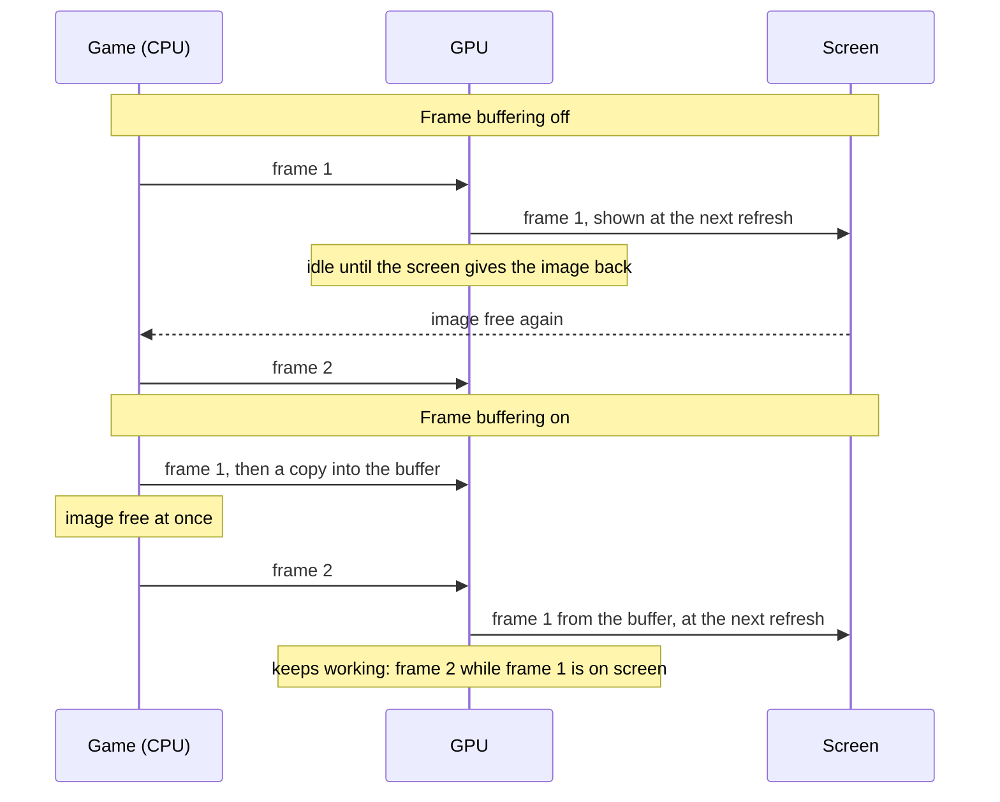
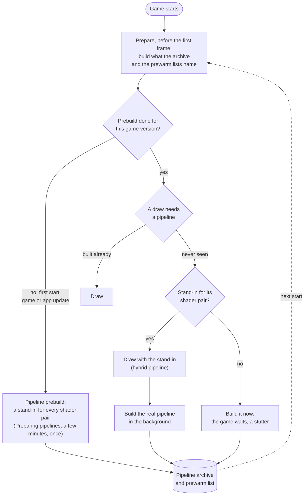
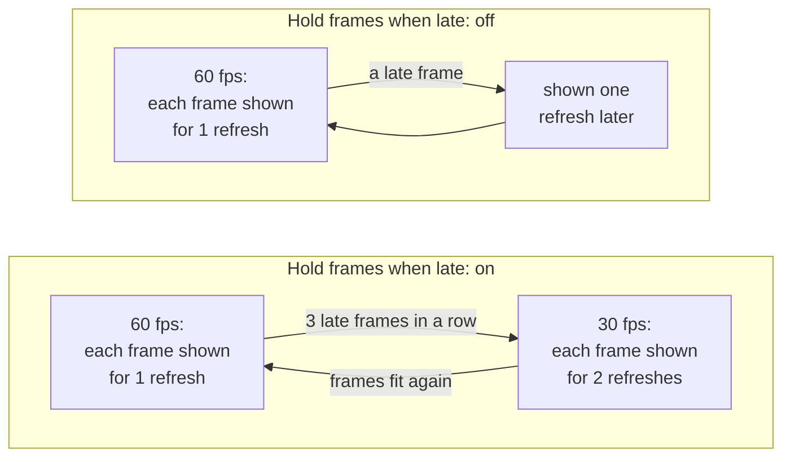

# Settings

The screen before the game starts shows resource readiness, available memory and About information. Import ROM and graphics packages from the left panel, then press **Play**. **Settings** opens a separate two-column page: section titles on the left and their options on the right. Both columns remain visible on compact phones. The Controls section combines controller options, motion, saved touch layouts, normal/compact editors, left-stick parameters and the compact-portrait switch. The former Game section is displayed as Graphics. Editors open as a second page using the full width. The Mac launcher uses the same status-and-settings layout.

**About** at the bottom shows the build time in the device's local time zone and date format, on both iPhone and Mac.

Opening **Settings** during a game pauses gameplay and silences game audio until the page closes. Returning from another app keeps the game paused while Settings remains open.

On iOS, **Import ROM** and **Import graphics** sit below **Play** on this same page.
Each button is replaced by an imported status with a checkmark once its resource is ready.
Use **Refresh** to recheck files copied into the app manually.
When graphics are missing, the sole valid, compatible `.graphics` or legacy `.zip` package in the app's folder is automatically imported
on launch, on returning to the app or on refresh.
Choose the game image and separate graphics package in Files; import the original file without unzipping it. Play is enabled when
both are ready; incompatible graphics report the reason. Imports survive app
updates. About also shows the imported graphics version and recorded Metal
version when available. See [graphics packages](graphics-pack.md).

- [Tested defaults](#tested-defaults)
- [Graphics](#graphics): [Frame rate](#frame-rate), [Frame generation](#frame-generation), [Render scale](#render-scale), [Console mode](#console-mode), [Upscaling](#upscaling), [Game's upscaler](#games-upscaler), [Picture](#picture), [Game language](#game-language), [Frame-rate counter](#frame-rate-counter)
- [Controls](#controls): [Motion controls](#motion-controls), [Touch feedback](#touch-feedback), [Game rumble](#game-rumble), [Rumble strength](#rumble-strength), [Rumble cutoff](#rumble-cutoff)
- [Touch left stick](#touch-left-stick): BOTW movement deadzone, response curve, full movement and size
- [Performance](#performance): [Experimental low-memory mode](#experimental-low-memory-mode), [Memory transfer optimization](#memory-transfer-optimization), [Skip feedback snapshots (experimental)](#skip-feedback-snapshots-experimental), [Frame buffering](#frame-buffering), [Metal 4 pipelines](#metal-4-pipelines), [Pipeline prebuild](#pipeline-prebuild), [Encode thread](#encode-thread), [Hold frames when late](#hold-frames-when-late), [Reduce to 30 fps when hot](#reduce-to-30-fps-when-hot), [Performance HUD](#performance-hud), [Reset to tested defaults](#reset-to-tested-defaults)
- [The Mac settings window](#the-mac-settings-window): [Display mode](#display-mode)
- [In-game menu](#in-game-menu)
- [TV](#tv)
- [Settings in a file](#settings-in-a-file)

## Tested defaults

Each game comes with the settings it was tested with: its profile in this repository says, for example, that Breath of the Wild runs with Frame buffering and Metal 4 pipelines on, because that combination held a steady 60 fps on an iPhone 17 Pro Max. Those are the defaults the settings screen shows the first time.

When you change a setting and tap **Play**, the app keeps your choice, also when a later build of the app ships other defaults. A setting you leave at its default is not stored: it follows the defaults of the build you have, so a newer build's tested settings reach you without doing anything. BOTW's low-memory switch is the exception: manual On and Off are saved immediately, while an automatic choice is recalculated at launch. **Reset to tested defaults** at the bottom sets every setting back to its default, and **Play** then forgets your choices, so the game's defaults apply again. For testing, a line in `Documents/env.txt` overrides any setting ([Settings in a file](#settings-in-a-file)).

A Mac app carries the same list (`Contents/Resources/dm/launcher.json`), without the iPhone's own Frame-rate counter and Touch feedback, for a front end that starts the app with the chosen values ([Front ends](frontends.md)).

## Graphics

### Frame rate

Games whose speed the app controls (Breath of the Wild, Tears of the Kingdom and a few others) offer **30 fps** or **60 fps**. 60 is smoother; 30 is what the Switch ran and uses less power, so the phone stays cooler and the battery lasts longer. The game runs at real speed either way.

### Render scale

The size of the 3D picture, from 50 to 100 %. Below 100 % the size is fixed there and the game's own dynamic resolution is off; 100 % keeps the game's own. Lower can be lighter on the GPU but is blurrier; the HUD and text keep their sharpness. Only games the app can scale offer it.

### Console mode

**Docked** renders at the Switch's TV resolution, **Handheld** at its lower handheld resolution, which is lighter on the phone and can give a higher frame rate.

### Upscaling

BOTW's experimental **Dynamic resolution** option keeps its native 80–100% scale controller but targets the selected frame rate, including the movie and thermal 30 fps caps. A fixed **Render scale** takes precedence. With this option off, BOTW keeps its original resolution policy.

**Upscaling** is one choice, defaulting to **Standard**:

- **Standard** keeps the game's normal scaling.
- **Scene MetalFX** (experimental, on verified profiles such as BOTW) scales 3D before the native scene composite and HUD. Text and UI keep their native rendering.
- **Full-screen MetalFX** scales the final picture, including text and UI, to the display.

The two MetalFX modes are mutually exclusive. Scene mode is offered only when the game's scene composite has been verified. MetalFX costs GPU time and does not guarantee a higher frame rate.

Breath of the Wild renders 1280x720 in handheld mode. Docked it renders its world at 900p and scales that to 1080p itself, before the app sees the picture. Full-screen MetalFX works in either console mode: handheld saves the most GPU time and heat, docked looks sharper than smooth scaling. Rendering at the screen's resolution stays the sharpest picture, where the GPU can afford it.

- **When to change it:** choose a MetalFX mode if the picture looks soft and the device has GPU time to spare: on a Mac, or on an iPhone in handheld mode at 30 fps. For long sessions at 60 fps on an iPhone leave it at Standard.
- **Cost:** more GPU time each frame, which can increase heat on an iPhone. [Breath of the Wild's measurements](../dm/games/01007EF00011E000/notes/rendering.md#upscaling-current) cover Mac and iPhone; the matching iPhone Standard run and MetalFX's share of the thermal cost remain unmeasured. Full-screen MetalFX only acts when the final picture is smaller than the display; Scene MetalFX only acts when the verified 3D input is smaller than its UI canvas. Unsupported devices and sizes use Standard scaling.
- **On the Mac:** choose **Full-screen MetalFX** under **Settings** > **Graphics** > **Upscaling** in the [settings window](#the-mac-settings-window), or set `DM_PRESENT_UPSCALE=metalfx` in its `env.txt` (off by default). It helps in a large window or on a 4K screen.

### Game's upscaler

Shown only for games that upscale their own picture with a network of their own before the app sees it: agl's NDSR network, in Donkey Kong Bananza and Splatoon Raiders. **Game's own**, the default, keeps the game's upscaler. **MetalFX** replaces it with Apple's MetalFX spatial scaler: the same input and output sizes, at a fraction of the GPU time, but Apple's scaler's picture rather than the game's.

- **When to change it:** when the game falls short of its frame rate in busy scenes because of GPU time: Donkey Kong Bananza's upscaler is the largest single piece of a heavy frame on an M1 (3.5-5 ms of about 24 in handheld mode). Compare the look side by side before keeping it.
- **Cost:** none in GPU time (it saves 2.5-4 ms a frame in that case); the picture is Apple's scaler's rather than the game's. Frames where the game renders at its output size are not upscaled and keep the game's shader either way. Devices without MetalFX keep the game's upscaler.
- **Not the same as [Upscaling](#upscaling):** that one scales the finished picture, HUD included, to the screen; this one replaces the game's own step inside the frame. Both can be on.

### Game language

The game's own languages. By default, the app follows the device's preferred languages, choosing one the game supports. If none match, it uses the language the app was packed with. A manual selection is remembered, including a choice equal to the current system default. Reset to tested defaults restores automatic selection. The same rules apply when the startup screen is skipped; changing the language while playing takes effect at the next game start.

### Picture

iPhone and iPad. **Fit**, the default, shows the game's picture (16:9, or the taller one of [Picture shape](#picture-shape)) as large as it fits, with black bars where the screen has another shape. **Fill** enlarges it until it covers the whole screen and crops what lies outside; nothing is stretched. An iPhone loses some of the top and bottom, an iPad some of each side, so health bars, subtitles or maps near the edges can be cut off. A picture that fills the screen without cropping needs a patch for each game that renders a wider view. Fill applies in landscape; in portrait the picture stays fitted above the controls, and on a TV it is always fitted.

### Picture shape

Games whose profile supports it (Breath of the Wild, Animal Crossing: New Horizons). **iPhone Duo screen (1.43:1)** renders a taller picture of the Duo's own shape: the sides of 16:9 with more above and below, and the HUD at the screen's edges. **16:9** is the Switch's picture. The taller picture has about a quarter more pixels, so it runs a little slower and warmer.

### Frame-rate counter

Shows the frames per second at the top left. With frame generation enabled, it shows source frames plus confirmed generated frames, for example **30+30 fps** or **60+60 fps**. Both values are measured over the last second; missing generated pictures are not counted.

## Controls

### Motion controls

Choose **Off**, **Automatic**, **Controller** or **Device gyroscope**. Automatic is the default: a fresh controller motion sample wins, otherwise the phone's gyroscope supplies player 1. Controller and Device gyroscope select only that source; Off disables both. The choice applies immediately. A Mac has no phone gyroscope, so Device gyroscope supplies no motion there. `DM_MOTION_SOURCE=auto|off|controller|device` is the file/environment equivalent. See [source routing](reference/services.md#live-controller-motion) for the shared input implementation and device-validation limits.

### Touch feedback

A light tap from the phone when you press an on-screen button.

### Game rumble

The game's vibration, on the phone or on a connected controller.

### Rumble strength

How strong the game's vibration is, from 0 to 300 %.

### Rumble cutoff

A controller's vibration weaker than this stays off, and the rest is spread over the full range. Off (0 %) by default. A controller with rotating motors can rumble all the time in a game that sends a quiet texture: Mario Kart 8 Deluxe needs about 45 % to rumble only on crashes and drifts. The phone's own vibration is not affected.

## Touch left stick

Breath of the Wild has touch layout options under **Settings → Controls** before **Play** and during gameplay. **Normal layout** and **Compact layout** open a full-screen editor with a translucent panel at the top center. The canvas uses the actual control area's point dimensions, without a sidebar or a scaled preview. In Duo Seated mode, the buttons belong to the lower control pane; folds update that area even when the window size stays unchanged. The separate left-stick parameter page keeps its read-only response chart and parameter sliders. These settings apply only to BOTW touch mode; physical controllers and other games keep their existing behavior.

Select a control on the canvas or in the panel's control picker. Drag it to move; pinch or use the panel's single **Size** slider to resize it. There are no position sliders. **Save** remembers the current layout immediately and returns to settings, both before Play and during gameplay. **Exit** discards changes since opening the editor, including resets. Editing a draft does not change the running game. Normal and compact banks save independently; unrelated game choices still wait for Play. The compact editor allows portrait rotation without enabling compact portrait gameplay.

The editor loads the same button images and uses the same shield, movement-arrow, D-pad and menu-key paths and palette as the game. Idle movement shows its small translucent center and inner arrows; idle ZL shows the shield graphic. Their full touch areas are not rendered as extra circular buttons. A dashed selection outline marks the selected control's editable area. Fixed **+** and **−** are also shown.

Selecting **Shield stick** also shows a **Touch diameter** slider beside Size. It adjusts the circular touch-down area in points without changing the shield artwork or movement response. A dashed circle previews that area. Normal and compact layouts save separate diameters, including in exported JSON. Older layouts retain their former touch diameter on first load; subsequent artwork resizing leaves the saved diameter unchanged.

Use **Add button** to add Weapons, Shields, Food or Whistle. Select a removable control and use **Layout options → Remove button** to hide it; the same Add menu restores it. Normal and compact layouts keep separate choices. Each added button has its own point size and draggable position. The category and horse glyphs come from the installed game's own `Bootup.pack` resources, prepared into the external build and bundled into the app; no extracted game textures are kept in this repository.

Weapons and Shields offer **Open inventory**, **Hold to switch**, and **Tap to switch**. Inventory opens the matching native category. During bow use, their glyphs become Bow and Arrow, and inventory opens the bow category. Hold opens the native quick strip until release. Tap keeps the strip open until Cancel. While it is open, other virtual buttons disappear; sticky mode keeps only the red Cancel glyph. The native quick-strip buttons, including runes, accept direct taps through their live hit targets without closing the strip. Cancel also stops touch bow aiming or throwing through the existing frame-acknowledged cancel sequence.

L keeps its existing native action by default. Its other modes open the native rune strip after a 0.20-second hold; a shorter tap still sends L. Choose release to close, or keep the strip open until Cancel. R and ZR each offer **Drag to cancel** (the default) or **Drag to look**. Camera dragging keeps the trigger held and does not cancel on release outside its circle; the red Cancel glyph remains available. These choices save separately in normal and compact layouts and in shared layout files. Hiding the D-pad restores the equipment/rune display's original game position and size; it does not disable the other touch HUD controls.

A, B, X and Y each have their own position and diameter. The D-pad and its equipment icons move and scale as one group. Left stick, shield stick, Rune (L), R and ZR adjust separately. **+** and **−** stay fixed. Offsets and diameters are measured in frontend points (pt). Right and bottom margins are fixed; normal-layout base left margins contract below 800 pt of control-area width, multiplying by width / 800 with a minimum factor of 0.8. At 669 pt wide, the left-stick margin is about 50.51 pt and the D-pad margin is about 205.80 pt. Compact left margins remain fixed. Safe-area insets and picture bars do not affect these anchors. User point offsets apply after the base margin calculation, and resizing grows toward the inside of the anchors. In Duo Seated mode, these anchors belong to the lower control pane.

The panel's **Reset** menu offers **Restore this control**, which resets the selected control's position and diameter, and **Restore this layout**, which resets the current bank including its left-stick response. Both affect only the draft until Save. The Controls menu's **Restore all touch defaults** still resets both banks. Frame rate and graphics settings stay unchanged. The panel's options menu contains **Corner button labels**, which shows or hides the small letter circles on L, R, ZR and XYAB, and **Export layout**. The saved-layout section offers **Import layout** and **Export layout**, using JSON files. R and ZR have the same base diameter, with independent size controls.

| Setting | Default | Range | Effect |
|---|---|---|---|
| Deadzone | 7% | 0–30% | Small drags within this fraction of the radius produce no movement. |
| Response curve | 0.30 | 0.30–2.00 | Below 1 makes short drags stronger; 1 is linear; above 1 makes them gentler. |
| Full movement at | 71% | 35–100% | How far to drag, as a fraction of the radius, to reach maximum stick strength. |
| Stick diameter | 123.2 pt normal; 111.7 pt compact | 20–240 pt | Sets the outer ring and drag range; center artwork follows its size. |

**Saved touch layouts** selects the active named layout. Each contains separate normal and compact banks. **Manage layouts** creates a default layout, duplicates the current one, renames it or deletes it. At least one remains; missing or unusable local layout data falls back to a default layout. Switching, creating and deleting layouts are remembered immediately without changing graphics choices.

**Export JSON** saves either the current named layout or all named layouts with the system file picker. **Import JSON** adds layouts without replacing existing ones or changing the selection. Colliding names receive a suffix and every imported layout gets a new local identity. Files contain `schemaVersion: 1`, the game ID, and a `layouts` array. Each layout has a name and normal/compact banks; a file may contain one layout or many, and a layout may omit either bank to use defaults. Banks hold named controls with `anchor` (`left` or `right`), `sidePt`, `bottomPt`, `sizePt`, and validated per-bank response/visibility/action options. Vertical positioning always uses the bottom edge. The bounds are those of the actual control pane, independent of safe areas. Invalid files and unsupported versions leave the library unchanged. Up to 256 layouts and 4 MiB per file are supported.

Dragging selects a horizontal anchor from the side where the control is placed. Explicit point margins then follow that side and the bottom edge on other screens; the original left-side width adaptation no longer applies to that customized control. Import fits controls back inside the target pane, reducing a diameter only if the pane is smaller than the button. The same edge fitting is used when a pane changes after import. **Copy layout JSON** copies the current editor draft in the same portable format without saving it.

The BOTW launcher and touch editor follow the app's system language, with English and Simplified Chinese resources. Game language remains a separate setting.

The curve updates as you adjust the sliders. Drag across it to see the stick strength at each finger distance. Tap **Play** to save your choices for the next start. A value fixed by an env file stays fixed, including when restoring defaults.

Button and stick diameters stay constant when the window changes size. These settings do not add an overshoot sprint gesture; B keeps its ordinary action.

On the Mac, touch preview uses the same movement-response parameters through `DM_BOTW_MOVE_DEADZONE`, `DM_BOTW_MOVE_CURVE` and `DM_BOTW_MOVE_FULL` in `env.txt` or the launch environment. These response fractions remain decimals: `DM_BOTW_MOVE_DEADZONE=0.07` means 7%. Packaged Mac apps expose the same touch options under Controls; the raw host uses the launch environment.

Layout keys are `DM_BOTW_PAD_<CONTROL>_X_PT`, `_Y_PT`, `_SIZE_PT` and `_ANCHOR`, where `<CONTROL>` is `A`, `B`, `X`, `Y`, `STICK`, `DPAD`, `ZL`, `L`, `R`, `ZR`, `WEAPON`, `SHIELD`, `FOOD`, `WHISTLE` or `CANCEL`. Size is the full outer diameter. Anchor 0 keeps the original default-plus-offset rules: positive X moves right and positive Y moves down. Anchor 1 selects the left edge and anchor 2 the right edge; for these explicit anchors X is the side margin and Y the bottom margin, both nonnegative pt distances. Compact keys insert `PORTRAIT_` after `DM_BOTW_`. For example, `DM_BOTW_PAD_A_X_PT=-20` moves only normal A left by 20 pt; `DM_BOTW_PORTRAIT_PAD_B_SIZE_PT=50` sets only compact B to a 50 pt diameter. Optional controls use `_ENABLED=0|1`, D-pad uses `DM_BOTW_PAD_DPAD_VISIBLE=0|1`, and Weapons/Shields/L use `_MODE=0|1|2` in the order described above. The former fractional offset, scale and XYAB-group keys are retired. Saved launcher customizations are converted to point values using the former reference phone layouts; new point choices take precedence, and Reset does not restore the old fractions. Explicit point overrides in the environment or an env file remain locked.

Corner letter circles are off by default; `DM_BOTW_PAD_BADGES=1` enables them. **+** and **−** retain their existing safe-area and HUD layout. The runtime and Restore defaults match `dm/games/settings.tsv`. Compact selection uses the control area's actual width below 600 pt in an upright window; safe-area changes alone do not switch layouts.

During BOTW touch gameplay on iPhone, **double-tap with three fingers** to toggle the temporary full gamepad and its Settings button together. **Close**, directly to the right of Settings, hides the temporary pad and restores ordinary touch controls. When the FPS counter is shown, tapping it opens the same settings page, including while a physical controller is connected. The same settings page is available without restarting the game. Touch layout, stick response, touch feedback, rumble, supported frame-rate/render-scale controls and operation mode apply immediately; other rows say they apply on the next start and are saved without changing the running game. Cloud-save changes remain available before starting the game. The gesture also works over menus with direct touch handlers. Repeating it closes the temporary controls and restores normal touch policy. A menu transition or controller connection clears the temporary controls and their Settings/Close buttons. Camera-area double taps do not open the scope within a fixed 100pt-diameter circle around a visible right-side button (or anywhere inside a larger button). This protection follows actual custom positions and does not block camera dragging.

If a BOTW menu does not respond to direct touch on iPhone, **double-tap with three fingers** to reveal the original full virtual gamepad and the Settings button for that menu visit. It sends ordinary buttons and UI right-stick input. The temporary override is not saved. Input reset releases pressed buttons without changing its visibility. Only the hidden-menu fallback reserves the three touches early; ordinary gameplay combinations keep working until a Settings double tap is recognized.

The first **Play** in BOTW touch mode on iPhone explains this gesture and asks players to report buttons that do not respond. Acknowledging the notice starts the game and keeps it from appearing again, including after resetting settings. A connected controller skips the notice without marking it acknowledged.

## Performance

These settings change how the app hands frames to the screen and how it prepares the GPU's work. The game's tested defaults are a good start; change them when a game stutters, runs hot, or you want less latency.

### Frame generation

Open **Settings → Game** in the shared iOS/Mac launcher or in-game settings. **Frame rate** is a 30/60 segmented control; **Frame generation** is a separate, default-off switch. Together they select 30, 30+30, 60 or 60+60. Changing the base rate while interpolation is on updates its source rate too. Both choices are remembered, and supported runtime changes take effect at the next real-frame boundary. The standalone interpolation menu and floating button are removed.

The switch is shown only for profiles with configured inputs, currently BOTW in Docked and Handheld modes. Handheld uses a smaller native canvas. GPUs without native interpolation support keep normal rendering and the base frame rate. An explicit environment override remains locked. Numeric environment modes `40`, `50` and `max` remain diagnostic backend options outside this UI. [BOTW validation and remaining work](../dm/games/01007EF00011E000/notes/rendering.md#experimental-metalfx-frame-generation).

### Experimental low-memory mode

BOTW only, on the experimental memory branch. With no saved manual choice, the launcher selects **on below 4.5 GiB of available memory** and **off at or above 4.5 GiB**. iPhone uses the current app's memory headroom (`os_proc_available_memory`), rather than installed RAM; Mac estimates reclaimable memory from free and inactive pages. If detection is unavailable, the default is off. Physical-iPhone validation of this threshold is still needed.

Manual **On or Off is remembered immediately**, including a choice equal to the automatic default, and takes priority on later launches. Automatic choices are not saved. **Reset to tested defaults**, followed by **Play**, clears the override and returns to automatic selection. Existing launch/environment-file overrides keep their usual priority. When enabled, a notice below **Play** explains that the mode helps keep the game running and may affect performance.

The mode uses file-backed guest memory, shorter-lived GPU upload sources and a smaller pipeline cache learned during play. The app chooses its own temporary folder; no paths or extra environment options are needed.

The preset disables whole-game pipeline prebuild and the bundled pipeline archive, so the **Pipeline prebuild** setting is hidden while it is on. Storage activity can increase, and a new scene may pause to compile pipelines. The existing full cache and saves are retained. To compare modes, close and relaunch the app, change the switch and use the same save and scene. It cannot change an already running game's heap.

With the switch off, the original heap, GPU pool handling and pipeline/cache settings remain in use. Older experiment environment flags cannot enable the memory changes on their own.

Mac measurements showed a reduction, but the iPhone result remains unverified. [Preset details, log checks and measurement limits](experiments/file-backed-memory.md#enable-from-the-game-overlay).

### Memory transfer optimization

NVN games only, on by default on iPhone and Mac. It reuses compatible render
passes, avoids storing unchanged images and allows feedback snapshots to use
lossless compression. Turn it off if rendering glitches appear. Play applies
and remembers the choice; changing it requires restarting the game.

This setting is independent of **Skip feedback snapshots (experimental)**.
With automatic snapshots kept, required protective copies remain. If snapshot
bypass is enabled, only the optimization's snapshot-allocation part becomes
inactive; its render-pass and store rules still apply. Reset restores this
optimization to On and snapshot bypass to Off.

### Skip feedback snapshots (experimental)

NVN games only, off by default on iPhone and Mac. Turning this experiment on skips the copies that protect a draw reading a colour attachment it also writes. It may reduce GPU work, but can produce incorrect colours, blocks or other rendering errors. It does not provide replacement protection. Frame-rate and thermal improvements on iPhone have not been established.

The choice is saved when you press **Play** and applies to that game run. To compare it with normal rendering, fully close the app, reopen it, change the switch and load the same scene. Turning it off, or using **Reset to tested defaults** followed by **Play**, restores automatic feedback snapshots. An explicit `env.txt` or launch-environment override takes priority: `DM_NVN_FB_SNAP=0` skips snapshots, `1` restores automatic snapshots, and the existing diagnostic value `all` still requests a fresh snapshot for each sampling draw.

This setting controls [same-pass feedback snapshots](reference/rendering.md#same-pass-feedback-read-through-a-snapshot). **Frame buffering** below controls the separate copies used to display finished frames.

### Frame buffering

Each finished frame is copied into a buffer of two images that the screen shows from, so the game can start its next frame at once instead of waiting for the screen to give its image back.

Without it the GPU idles between frames, and iOS reads that idle time as room to spare: it lowers the GPU's clock, and the frames take longer still. On an iPhone 17 Pro Max, Breath of the Wild fell to 30 fps without frame buffering and held 60 with it.

- **When to change it:** turn it off if you notice the controls lag behind and the game holds its frame rate without it.
- **Cost:** up to one frame more latency between your input and the screen (about 28 ms more on an iPhone 17 Pro Max), and two more frame-sized images in memory.

### Metal 4 pipelines

Before the GPU can draw something, the app has to build a *pipeline* for it: the game's shaders compiled for the iPhone's GPU, with the drawing settings. Building one takes tens of milliseconds, so a scene full of new ones stutters. With Metal 4 pipelines the app keeps what it built in a pipeline archive on the phone, and builds most pipelines in a few microseconds from a shared base.

At start, before the game's first frame, the app prepares what it already knows: the pipelines in the archive and those the prewarm lists name (one comes with the game, one grows on the phone as you play); with a warm archive that takes well under a second. A pipeline never seen before is drawn meanwhile with a stand-in for its pair of shaders, a *hybrid* pipeline that reads the draw's vertices in a general way and draws the same picture, while the real pipeline is built in the background and archived for the next start.

- **When to change it:** turn it off only if a game crashes or runs out of memory with it.
- **Cost:** memory for the archive while the game runs, and storage on the phone.

### Pipeline prebuild

Builds a stand-in for every pair of shaders the game has (15,767 for Breath of the Wild) and puts them into the pipeline archive, so that a scene you have never seen has a stand-in for each of its draws instead of a stutter. It runs before the game's first frame, behind a **Preparing pipelines** screen: the first start waits a few minutes for it, once, and so does the first start after a game update or an app update that brings new shaders. Every other start skips it. It needs Metal 4 pipelines, and its row shows only while that option is on.

Built in the background while playing instead, the stand-ins took an iPhone 17 Pro Max's GPU from about 13 to 15–18 ms a frame in Breath of the Wild, so the app does the work up front.

- **When to change it:** turn it off if you don't want to wait at that first start.
- **Cost:** on, a wait of a few minutes once. Off, no wait, but a pipeline seen for the first time makes the game stall briefly while it is built, until the archive holds it.

### Encode thread

The app turns the game's graphics commands into Metal commands on a thread of its own instead of the game's submitting thread, so the game's thread can go on sooner (in Breath of the Wild about 4 ms per frame instead of 8). Frame buffering needs it for games that present their frames from another thread than the one that draws them. It is on by default on the iPhone; on the Mac it is off, where it lowered the typical frame time but made the slowest frames slower.

- **When to change it:** leave it on unless a game misbehaves with it; turning it off is a diagnostic step.

### Hold frames when late

For games whose frame rate the app controls ([Frame rate](#frame-rate)). With 60 fps chosen, each frame is meant to stay on screen for one refresh. When a frame comes late, the app can either slow the game down to 30 fps for a while, or keep 60 and show late frames as they come.

- **On** (the default for most games): an even 30 fps (or 20) in heavy scenes instead of a mix of 30 and 60.
- **Off:** the game keeps aiming at 60; a late frame is shown one refresh later and the next one goes on as usual, so heavy scenes look less even but stay closer to 60 on average.
- **When to change it:** turn it off if the game often falls to 30 fps although it is only slightly late.

### Reduce to 30 fps when hot

iPhone and iPad only, for builds with the app's frame-step control. Off by default.
When enabled, a serious or critical system thermal state caps the game at 30 fps.
The selected cap returns after the device has stayed fair or cooler for 30 seconds.
The choice is saved when you press **Play** and applies on the next game start.

With it off, the app adds no temperature-based 30 fps cap. The selected frame rate,
movie limits and **Hold frames when late**, including its recovery to 60 fps,
continue to apply. iOS still manages the device's frequencies and thermal limits.
`DM_THERMAL_CAP=1` in `Documents/env.txt` enables the same option; unset or `0` is off.

### Performance HUD

Apple's performance overlay over the game: frame rate, frame and GPU times, memory. Useful to see what a setting changes; leave it off for play.

### Reset to tested defaults

Sets every setting back to the game's tested default; **Play** then forgets your choices, so those defaults apply, and those of later builds too ([Tested defaults](#tested-defaults)). Settings fixed by `Documents/env.txt` stay as the file says.

## The Mac settings window

A Mac app ([A Mac app](development.md#a-mac-app)) opens a dashboard before the game starts, with resource readiness, available memory and About on the right. **Settings** opens the same two-column editor as on iPhone: choose a section on the left and edit its options on the right. The settings and defaults match the game's iPhone list except for **Frame-rate counter** and **Touch feedback**, which are iPhone-only. **Render scale** shows the picture's size in pixels beside the percentage for the chosen **Console mode**, when the game's profile has it (Breath of the Wild: 1600 × 900 docked, 1280 × 720 handheld at 100 %). **Reset to tested defaults** restores all unlocked settings.

Click **Play** (or press Return) to start the game. **Quit**, ⌘Q or closing the window ends the app without the game. The app remembers your choices for that game, and a game started without the window, from a front end or with the window turned off, uses them too ([Saved choices](frontends.md#saved-choices)). A setting fixed by an `env.txt` or by the program that started the app is shown greyed out.

Turn off **Show this window at launch** to start the game at once with your choices. Hold Option while the app opens to see the window again. `DM_LAUNCHER=0` in the app's `env.txt` (`~/Library/Application Support/nxnative/<title ID>/env.txt`) or in its environment, or opening it with `open <app> --args --no-launcher`, also skips the window; your choices still apply. `DM_SAVED_CHOICES=0` starts with the tested defaults instead.

Direct runs through `scripts/run_mac.py` show the same dashboard before loading the game. The dashboard, status rows, first-touch notice, settings page and touch editor share the iOS SwiftUI implementation; Mac code supplies resource paths, images and native window/input handling. The launch-window toggle lives in Game settings and is hidden in touch preview. Preparation records the launcher JSON and localized text with the runtime; an environment or command-line override stays locked, while generated defaults remain editable. During play, **Command-comma** opens the shared settings editor. Supported frame-rate/render-scale, operation-mode, rumble and BOTW touch-preview changes apply immediately; the remaining options are saved for the next start.

In BOTW `--touch-preview`, **Command-Shift-comma** mirrors the iPhone's three-finger double tap: it toggles Settings and temporary virtual controls together, including screens with direct touch handlers, with native UI right-stick input. Repeating it, changing menu mode or ending touch preview closes the temporary controls. A connected controller disables this touch-preview shortcut; the ordinary **Command-comma** Settings command remains available.

### Display mode

**Window** or **Fullscreen**: how the game's window opens. ⌃⌘F or the green button changes it while you play. In an `env.txt`: `DM_FULLSCREEN=1` or `0`.

### Cloud saves folder

**Choose a folder…** picks the iCloud Drive folder the game's save is synced through, the one the iPhone app chose in its launcher's **Cloud saves**, or the game's own folder inside it, named after its title ID ([Cloud saves](#cloud-saves)); **Turn off** stops it. Off by default. macOS may ask once whether the app may open iCloud Drive; if the game log says `this app may not open iCloud Drive`, allow it in System Settings › Privacy & Security › Files and Folders. In an `env.txt`: `DM_SAVE_SYNC=<folder>`, or `DM_SAVE_SYNC=icloud` for iCloud Drive › nxnative Saves; the window then shows it fixed.

## Cloud saves

The Mac app and the iPhone app of one game can share a save through iCloud Drive. Choose the same iCloud Drive folder on both: **Cloud saves** › **Choose a folder…** in the Mac settings window, and **Cloud saves** in the iPhone launcher (any folder, for instance one named **nxnative Saves**). Each game keeps one file there, `<title ID>/save.dmsync`, which holds the whole save.

When the game starts, it brings the save from iCloud Drive in if that one is the one to keep; a few seconds after the game saves, it sends its save. The iPhone app also sends when it goes to the background, and the Mac app once the game has quit. If you played on both without the save getting across in between, the newer save wins.

A save that is replaced, on the device or in iCloud Drive, is kept first, beside the save in a folder named after it with `-backups` (on the iPhone `save-backups` in the Files app, under the app's name; on the Mac `~/Library/Application Support/nxnative/<title ID>/save-backups`): `<date> local` holds this device's save, `<date> cloud` the one that was in iCloud Drive. The newest 10 of each kind stay, and older ones are removed; other folders you put there are left alone.

iCloud Drive takes a moment to carry a file from one device to the other. Quit the game on one device and give it a few seconds before you start it on the other. Without a connection the game plays on with the save it has and sends it later. The game log says what came in and what went out (lines starting with `save sync:`).

## In-game menu

On the iPhone and iPad the gear at the top centre of the touch controls opens a menu while the game runs; it stays when a controller hides the other controls. It holds **Console mode**, **Picture** and the **Frame-rate counter**, then **Controller layout** (**2D**, **3D**, and **Tap**, no controls and every touch to the game, in handheld mode), **Touch feedback** and **Game rumble**: the settings that take effect at once. A choice opens to show its options, the current one ticked. The menu's text keeps one size whatever the system text size, so it stays short over the game. A change is remembered as on the settings screen, which shows it at the next start; a setting `Documents/env.txt` fixes is shown, not changed. The other settings need the game to start again, so they are only on the settings screen: close the app fully and open it again.

Console mode changes as on a Switch put in or taken out of its dock. While a TV shows the game it stays **Docked**, and the mode you pick applies when the TV is disconnected. **Docked** removes the Tap layout, as a docked Switch reads no touch screen.

## TV

Connect a TV or monitor by cable, or start Screen Mirroring to an Apple TV or AirPlay TV. The game fills it in 16:9 at up to 1080p and switches to **Docked**; the iPhone or iPad keeps the controls. Disconnect to bring the game back to the device in its earlier mode. AirPlay adds some delay; a cable has almost none.

## Settings in a file

A line like `DM_PRESENT_SNAP=0` in `Documents/env.txt` (in the Files app, under the app's name) sets a setting from the file: the settings screen shows it greyed out, and the file wins over your choice and the game's default. Fully close and reopen the app after editing the file. The variables:

| Setting | Variable | Values |
|---|---|---|
| Frame rate | `DM_FPS_TARGET` | `30`, `60` |
| Render scale | `DM_RENDER_SCALE` | `0.5` to `1.0` |
| Dynamic resolution | `DM_DYNAMIC_RESOLUTION` | `1`, `0` |
| Console mode | `DM_OPMODE` | `1` docked, `0` handheld |
| Game language | `DM_LANG` | a language code, such as `ja` |
| Display mode (Mac) | `DM_FULLSCREEN` | `1` fullscreen, `0` a window |
| Cloud saves folder (Mac) | `DM_SAVE_SYNC` | a folder; `icloud`: iCloud Drive › nxnative Saves; `0`: off |
| Picture (iPhone and iPad) | `DM_PICTURE_FIT` | `fit` 16:9 with black bars, `fill` covers the screen, cropped |
| Picture shape | `DM_SCREEN_ASPECT` | `1.43` the iPhone Duo's shape, `0` 16:9 |
| Frame-rate counter | `DM_SHOW_FPS` | `1`, `0` |
| Touch feedback | `DM_TOUCH_HAPTICS` | `1`, `0` |
| Game rumble | `DM_RUMBLE` | `1`, `0` |
| Rumble strength | `DM_RUMBLE_GAIN` | `0` to `3` |
| Rumble cutoff | `DM_RUMBLE_MIN` | `0` to `0.9` |
| Upscaling | `DM_PRESENT_UPSCALE` | `off`, `scene` (verified profiles), `metalfx` |
| Frame generation | `DM_FRAMEGEN` | `0` off (default); `30` or `60` follows Frame rate |
| Experimental low-memory mode (BOTW) | `DM_LOW_MEMORY` | `1`, `0` |
| Memory transfer optimization | `DM_NVN_PASS_REUSE` | `1` on (default), `0` off |
| Skip feedback snapshots (experimental) | `DM_NVN_FB_SNAP` | `0` skips (switch on), `1` automatic (switch off, default) |
| Game's upscaler | `DM_UPSCALER` | `game`, `metalfx` |
| Frame buffering | `DM_PRESENT_SNAP` | `1`, `0` |
| Metal 4 pipelines | `DM_PSO_MTL4` | `1`, `0` |
| Pipeline prebuild | `DM_PSO_PREBUILD` | `1`, `0` |
| Encode thread | `DM_NVN_ENC_THREAD` | `1`, `0` |
| Hold frames when late | `DM_FPS_HOLD` | `on`, `off` |
| Performance HUD | `DM_METAL_HUD` | `1`, `0` |

`DM_LAUNCHER=0` skips the settings screen; the choices you saved there still apply. `DM_SAVED_CHOICES=0` starts with the tested defaults and keeps your saved choices for later. How the settings are listed for each game: [dm/games/settings.tsv](../dm/games/settings.tsv).
